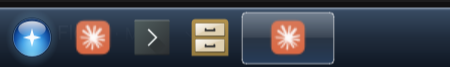
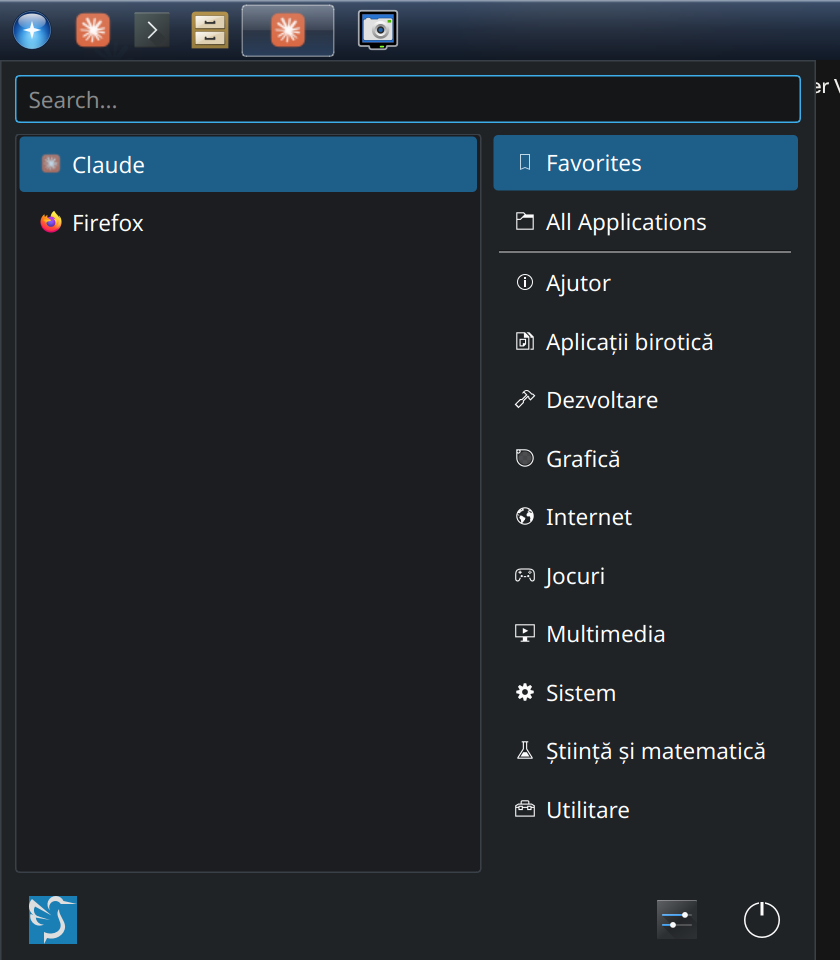
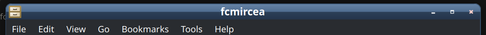

# lxqt-seven

A Windows 7-flavoured dark setup for **LXQt 2.3 on Wayland (labwc)**, running
alongside KDE Plasma 6 on Ubuntu 26.04. It came out of comparing how much GPU
memory each desktop uses on a hybrid AMD iGPU + NVIDIA machine.







## What's in it

| Path | What it is |
|---|---|
| `lxqt/themes/seven/` | Panel theme: glass-style blue-grey gradient bar, blue start orb, glassy icon-only task buttons, two-line clock, start menu styled like the context menu |
| `lxqt/themes/dark-code/` | Plainer dark panel theme with a blue accent (the stock "dark" theme with its red accent swapped out) |
| `lxqt/lxqt.conf` | Breeze Dark palette (`#202326` window, `#2a7db3` selection), Breeze widget style, breeze-dark icons |
| `lxqt/panel.conf.in` | Panel layout: start menu, Quick Launch (Claude, QTerminal, file manager), ungrouped icon-only taskbar (one button per window), tray, clock, show-desktop. No desktop switcher |
| `lxqt/session.conf.in` | Uses labwc as the compositor, skips LXQt's first-run compositor picker, and points the panel at `~/.local/lib/lxqt-panel` for the plugin below |
| `labwc/theme/Seven/` | labwc title bars to match: gradient active title, flat grey inactive, dark menus and Alt+Tab. The `.xbm` button glyphs are 8x8, about 30% larger than labwc's built-in 6x6 ones; themerc has no size key, so the bitmap size is the control, and the themerc colours still apply |
| `labwc/rc.xml` | LXQt's default labwc config, set to the Seven theme with breeze-dark icons, plus screenshot shortcuts and the mouse speed (machine-specific, see below) |
| `labwc/autostart`, `labwc/environment` | Monitor mode and scale, keyboard layout, iGPU pinning (machine-specific, see below); starts `notify-follow-tray` |
| `pcmanfm-qt/settings.conf.in` | Desktop wallpaper setting |
| `wallpaper/make-next-4k.py` | Generates a 3840x2160 copy of KDE's "Next" wallpaper (Plasma otherwise loads the 5120x2880 one on 4K) |
| `bin/snip` | Snipping-tool style screenshots with `grim` + `slurp`, saved to `~/Pictures/Screenshots` and copied to the clipboard |
| `bin/claude-desktop` | Wrapper that gives the Claude desktop app KWallet access outside Plasma (Electron otherwise disables encrypted storage) |
| `bin/notify-follow-tray` | Puts notifications in the screen corner next to the system tray, worked out from `panel.conf` (panel edge, and which end the tray sits at), and moves them again whenever the panel changes. `--watch` needs `inotify-tools`. A notification already on screen stays where it is: lxqt-notificationd reads the placement only when its area appears |
| `plugins/networkmonitor/` | lxqt-panel 2.3.2's Network Monitor plugin with the negotiated link speed and duplex added to its tooltip (`Link speed 2.5 Gbit/s, full duplex`). Wi-Fi and virtual bridges show `Link speed unknown`, since the kernel reports no negotiated rate for them. `install.sh` builds it into `~/.local/lib/lxqt-panel`, which the panel searches before the system copy; the change itself is `linkspeed.patch` |
| `bin/de-measure.sh` | Logs iGPU/NVIDIA memory, iGPU load and desktop RAM per session, for comparing desktops |
| `system/61-amd-igpu.rules` | udev rule creating a stable `/dev/dri/amd-igpu` symlink (optional, needs root) |

## Install

Requires LXQt's minimal pieces:

```bash
sudo apt install --no-install-recommends lxqt-core lxqt-wayland-session labwc wlr-randr qtxdg-tools screengrab grim slurp wl-clipboard python3-pil inotify-tools
```

Then, as your user:

```bash
./install.sh
```

It backs up anything it replaces to `~/.local/state/lxqt-seven-backup-<date>/`.
Log out and choose **LXQt (Wayland)** in SDDM.

The link-speed network monitor is built only when its build dependencies are
present (and the panel is 2.3.x); otherwise `install.sh` skips it:

```bash
sudo apt install --no-install-recommends cmake g++ qt6-base-dev libstatgrab-dev
```

Add the widget from the panel's *Manage Widgets* dialog. Rebuild it (re-run
`install.sh`) after an lxqt-panel upgrade to a new release; deleting
`~/.local/lib/lxqt-panel/libnetworkmonitor.so` brings back the stock widget.

### Machine-specific bits to adjust

- `labwc/autostart`: `wlr-randr --output HDMI-A-1 --mode 3840x2160@120 --scale 1.5`. Change it to your output name, mode and scale (`wlr-randr` lists outputs).
- `labwc/environment`: `XKB_DEFAULT_LAYOUT=ro` and `WLR_DRM_DEVICES=/dev/dri/amd-igpu`.
- `labwc/rc.xml`, `<libinput>`: pointer speed `-0.3` with adaptive acceleration for a Razer DeathAdder V2 Pro. libinput names it differently per mode (`Razer DeathAdder V2 Pro` on the cable, `Razer Razer DeathAdder V2 Pro` through the wireless dock), so there is one block for each. Other mice use the `default` block; `libinput list-devices` shows the names.
- iGPU pinning (optional, hybrid GPU machines): install the udev rule and point both compositors at the iGPU:

  ```bash
  sudo cp system/61-amd-igpu.rules /etc/udev/rules.d/
  echo 'KWIN_DRM_DEVICES=/dev/dri/amd-igpu' | sudo tee -a /etc/environment
  echo 'WLR_DRM_DEVICES=/dev/dri/amd-igpu' | sudo tee -a /etc/environment
  ```

  Remove the `WLR_DRM_DEVICES` line from `labwc/environment` if you don't use this.

## Keyboard shortcuts (labwc)

| Keys | Action |
|---|---|
| Super+Shift+S | Region screenshot (drag), saved and copied |
| Super+Shift+F | Full-screen screenshot, saved and copied |
| Super+Shift+G | ScreenGrab app |
| Print / Shift+Print / Ctrl+Print | Same three, for keyboards with a Print key |
| Super+U / I / J / K | Snap window to top-left / top-right / bottom-left / bottom-right quarter (press again to restore) |
| Super+C | Centre the window at 80% size |
| Super+Arrows | Snap to left / right / top / bottom half |
| Super+A | Toggle maximise |

Dragging also snaps, FancyZones-style: drop a window on a screen edge for a half,
in a corner for a quarter, at the top to maximise. Hold Ctrl, Alt, Shift or Super
while dragging to see and pick the predefined zones (`<regions>` in `labwc/rc.xml`).

## Firefox

Firefox draws its own title bar by default. To get the Seven title bar, right-click
the tab bar → **Customize Toolbar…** → tick **Title Bar**. The installer also links
the snap Firefox icon so it shows on the LXQt taskbar.

## Measured (one 4K monitor at 120 Hz and 150%, same apps open)

| | Plasma 6.6 | LXQt 2.3 + labwc |
|---|---|---|
| iGPU VRAM + GTT | 699 MiB | 267 MiB |
| Desktop session RAM | 593 MiB | 423 MiB |
| NVIDIA VRAM (compositor on iGPU) | 1 MiB | 1 MiB |

## License

LGPL-2.1-or-later. The LXQt panel themes are derived from
[lxqt-themes](https://github.com/lxqt/lxqt-themes) (LGPL-2.1+), and
`plugins/networkmonitor/` is code from
[lxqt-panel](https://github.com/lxqt/lxqt-panel) 2.3.2 (LGPL-2.1+). The wallpaper
is not included; `make-next-4k.py` builds it from your installed copy of KDE's
"Next" wallpaper (CC-BY-SA-4.0, Krystian Zajdel).
